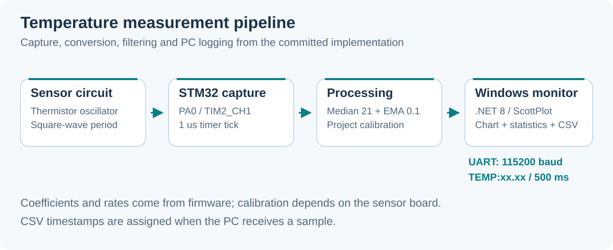

# STM32 Temperature Monitor

**Temperature measurement from a thermistor oscillator, with STM32 filtering and a Windows monitoring app.**

STM32F103C8T6 · TIM2 input capture · UART · C# WinForms / .NET 8 · ScottPlot · Altium

<a id="english"></a>

**English** · [Tiếng Việt](#tieng-viet)

A course project combining a custom sensor PCB, STM32 firmware and a desktop dashboard. The sensor circuit produces a square wave whose period is converted to temperature. Firmware filters and calibrates the result, then sends text measurements to the PC for plotting, statistics and CSV export.



*Pipeline derived from `main.c` and the WinForms parser; the diagram contains no measured sample data.*

## Measurement pipeline

| Stage | Implementation |
|---|---|
| Capture | TIM2 channel 1 on PA0, rising-edge period capture |
| Timer | Prescaler 71 with the configured 72 MHz timer clock: 1 µs ticks; 16-bit period 65535 |
| Conversion | `T_K = 1 / (0.003354 - period_us / 5569417)`; subtract `273.15` for Celsius |
| Spike filtering | Median of a **21-value** buffer after it fills |
| Smoothing | EMA: `filtered += 0.1 × (median - filtered)` |
| Calibration | `temperature = 1.104 × filtered - 1.7` |
| Transmission | `TEMP:xx.xx` plus CR/LF, every `500 ms` at `115200 baud` |

Several source comments still say 101 samples or 1% EMA. The implemented constants are **21 samples** and **alpha 0.1**. Filtering runs in the main loop (with a 10 ms delay) and may reuse the latest captured period; it is not synchronized to one update per fresh capture.

The conversion coefficients are project-specific calibration values, not a general thermistor equation for every sensor. No temperature-accuracy benchmark is supplied with the checkout.

## Repository layout

```text
STM32-Temperature-Monitor/
├── Hardware/BTL_DLCN/          # Altium schematics and several PCB documents
├── MCU/BTL/                   # STM32CubeIDE project and BTL.ioc
│   └── Core/Src/main.c        # Capture, conversion, filter and serial output
├── GUI/TemperatureMonitor/    # .NET 8 WinForms solution
└── docs/images/               # README pipeline illustration
```

## Wiring

| Signal | MCU connection |
|---|---|
| Sensor square wave | PA0 / TIM2_CH1 |
| UART to PC | PA9 / USART1_TX -> USB-TTL RX |
| Optional UART receive | PA10 / USART1_RX <- USB-TTL TX |
| Ground | Shared MCU/sensor/adapter reference |

The UART uses `115200`, 8 data bits, no parity and one stop bit. Use a TTL adapter compatible with the board's logic level, and verify the sensor waveform against the PCB design.

## Build and run

### STM32 firmware

```bash
git clone https://github.com/TuanLinh05/STM32-Temperature-Monitor.git
```

1. Import [MCU/BTL](MCU/BTL) as an existing project in **STM32CubeIDE**.
2. Check `BTL.ioc`, the STM32F103C8T6 target, timer clock and pin assignment.
3. Build and flash through ST-Link.
4. Connect the sensor and UART adapter. A serial terminal should show lines such as:

   ```text
   TEMP:25.43
   ```

   This is a format example, not a recorded reading.

### Windows desktop app

The [project file](GUI/TemperatureMonitor/TemperatureMonitor.csproj) targets **`net8.0-windows`**, with `ScottPlot.WinForms` 5.0 and `System.IO.Ports` 8.x. Use Windows, a compatible Visual Studio/.NET 8 SDK and NuGet restore.

```powershell
dotnet restore GUI/TemperatureMonitor/TemperatureMonitor.csproj
dotnet run --project GUI/TemperatureMonitor/TemperatureMonitor.csproj
```

Alternatively, open [TemperatureMonitor.sln](GUI/TemperatureMonitor/TemperatureMonitor.sln) in Visual Studio. Refresh/select the adapter COM port, choose `115200` and click **Connect**. Close other applications holding the same port first.

## Dashboard and CSV

- Live temperature plot and current/minimum/maximum/average values.
- Received sample counter and a Clear action that resets stored data.
- Export of the retained measurements to CSV with `Timestamp,Temperature_C` columns.

The GUI accepts `TEMP:` lines using invariant-culture number parsing. CSV rows use the PC's receive timestamp, rather than a timestamp emitted by the MCU. The GUI refreshes separately from the configured **2 Hz serial data rate**.

## Hardware and troubleshooting

Open [BTL_DLCN.PrjPcb](Hardware/BTL_DLCN/BTL_DLCN.PrjPcb) in Altium Designer to inspect the sensor board. Several PCB documents are present; confirm the board revision used for assembly and calibration.

| Symptom | Check |
|---|---|
| No serial samples | PA9 wiring, COM ownership, baud and firmware activity |
| Temperature stays constant after sensor disconnect | Firmware retains the latest period; a capture-freshness timeout is not implemented |
| Reading jumps or becomes unrealistic | Waveform integrity, timer overflow range, conversion denominator and calibration |
| Chart has no points | Prefix `TEMP:`, decimal format and incoming line termination |
| GUI will not build | Windows target, .NET 8 SDK and NuGet packages |
| CSV decimal format differs between PCs | CSV export formats values using the current system culture; review downstream parsing |

Source references: [firmware](MCU/BTL/Core/Src/main.c), [peripheral pin setup](MCU/BTL/Core/Src/stm32f1xx_hal_msp.c), [GUI parser/export](GUI/TemperatureMonitor/MainForm.cs).

---

<a id="tieng-viet"></a>

## Tiếng Việt

[English](#english) · **Tiếng Việt**

Hệ thống đo nhiệt độ cho bài tập lớn **ĐLCN tại HCMUT**: mạch thermistor tạo xung, STM32F103 đo chu kỳ và phần mềm Windows hiển thị/ghi dữ liệu.

### Luồng xử lý

PA0/TIM2_CH1 đo chu kỳ theo µs. Firmware quy đổi bằng các hệ số trong `main.c`, lọc trung vị **21 giá trị**, EMA **alpha 0.1**, rồi hiệu chuẩn `T = 1.104 × T_filtered - 1.7`. Dữ liệu `TEMP:xx.xx` được gửi mỗi **500 ms**, baud **115200**.

Các comment còn ghi 101 mẫu hoặc EMA 1% đã cũ; dùng hằng số thật trong code. Bộ lọc chạy theo main loop và có thể lặp lại chu kỳ mới nhất. Hệ số quy đổi cần hiệu chỉnh theo mạch/cảm biến thực tế.

### Khởi chạy

1. Import `MCU/BTL` vào STM32CubeIDE, kiểm tra `.ioc`, build và nạp bằng ST-Link.
2. Đưa xung cảm biến vào **PA0**, nối **PA9 TX** tới RX USB-TTL, chung GND. PA10 là RX tùy chọn.
3. Mở solution trong `GUI/TemperatureMonitor` với Visual Studio/.NET 8, restore NuGet, chạy, chọn COM và 115200 rồi **Connect**.
4. Dùng **Clear** để xóa phiên dữ liệu hoặc **Export CSV** để lưu.

GUI dùng ScottPlot 5 và `System.IO.Ports` 8.x. Timestamp CSV là thời điểm PC nhận mẫu. Khi cần phân tích CSV trên máy khác, kiểm tra dấu thập phân theo locale của máy xuất.

Nếu cảm biến mất xung, firmware hiện giữ period cũ vì chưa có timeout freshness; không nên xem giá trị đứng yên là phép đo mới. Kiểm tra timer, mẫu xung và hệ số hiệu chuẩn nếu nhiệt độ không hợp lý.

Thiết kế phần cứng: [Hardware/BTL_DLCN](Hardware/BTL_DLCN). Mã xử lý: [main.c](MCU/BTL/Core/Src/main.c). GUI: [MainForm.cs](GUI/TemperatureMonitor/MainForm.cs).

---

Developed by [Vu Tuan Linh](https://github.com/TuanLinh05) · HCMUT.
